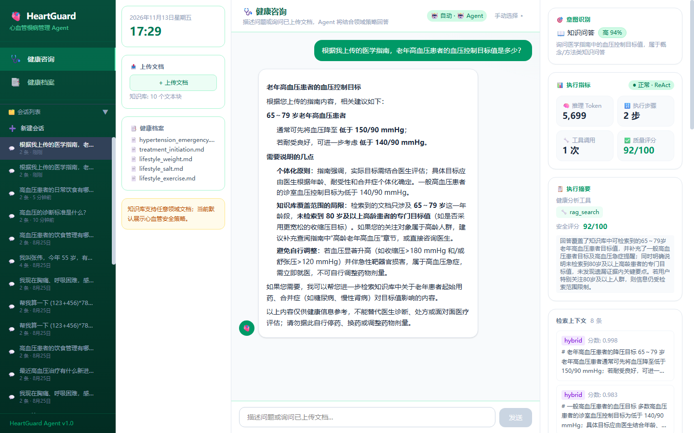
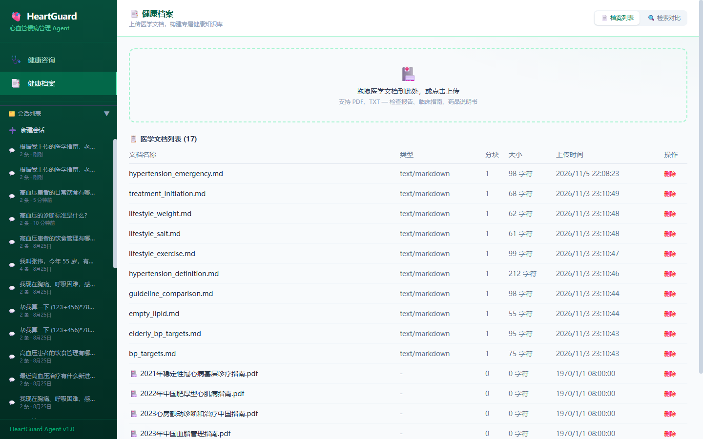
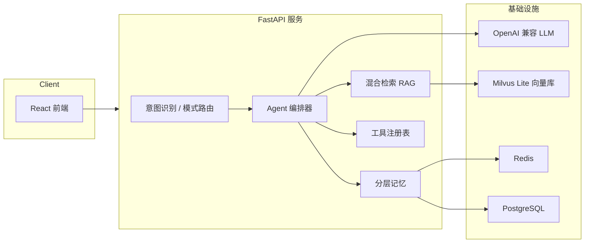

# HeartGuard · 心血管慢病管理 AI Agent

一个可插拔领域的 **Agent / RAG 工程底座**，以心血管慢病管理为默认 Demo，完整落地了多范式 Agent 编排、混合检索增强生成（RAG）、可插拔领域安全策略与分层记忆。

> 定位：**通用 Agent/RAG 底座 + 心血管领域插件**。通用底座不绑定医疗；医疗 Prompt、风险关键词与免责声明仅在 `cardiovascular` 策略下启用，用于展示高风险领域的安全分流与回答边界。

## 核心特性

- **多范式 Agent 编排**：`react` 与 `plan_execute` 两种范式按任务复杂度路由，支持 Function Calling 作为工具调用后端，含失败降级与反思评分。
- **混合检索 RAG**：BM25（jieba 分词）+ 向量检索（Milvus Lite）双路召回，RRF 融合，可选 Cross-Encoder 重排序，回答带来源引用。
- **可插拔领域策略**：`general` 处理通用文档，`cardiovascular` 叠加医疗安全提示、风险分级与拒答门控，可横向扩展更多领域。
- **分层记忆**：Redis 短期会话状态 → PostgreSQL 持久化 → 内存降级；长期语义记忆走向量存储。
- **工程健壮性**：LLM / Redis / Milvus 逐级降级、熔断保护、意图识别双通道、Agent 步骤追踪与可观测性埋点。
- **完整评测体系**：RAG 检索/生成评测 + Agent 通过率 A/B 消融，附带可复现的评测夹具与脚本。

## 界面预览

| 健康咨询 | 健康档案 |
| --- | --- |
|  |  |

## 架构



## 快速开始

### 最小本地模式

仅需 Python 3.11+、一个 OpenAI 兼容 API Key 与 Node 环境；PostgreSQL / Redis / Milvus 不可用时按链路自动降级。

```bash
python -m venv .venv
source .venv/bin/activate          # Windows: .venv\Scripts\activate
pip install -r requirements.txt
cp .env.example .env               # 编辑 .env，至少填写 OPENAI_API_KEY
python -m uvicorn app.main:app --port 8000
```

```bash
# 前端
cd frontend
npm install
npm run dev
```

### 完整 Docker Compose 模式

提供 PostgreSQL、Redis 与 Milvus standalone，适合演示持久化与独立向量服务。

```bash
docker compose up --build
```

## 技术栈

- **后端**：Python 3.11+ · FastAPI · Pydantic v2 · SQLAlchemy async · LangGraph / LangChain
- **检索**：BM25 · jieba · RRF · Milvus Lite · bge-m3 / bge-reranker-v2-m3
- **前端**：React 19 · TypeScript · Vite · Tailwind CSS 4 · Recharts
- **基础设施**：Redis · PostgreSQL · Docker Compose

## 项目结构

```text
app/
  core/agent/          # 多范式 Agent：react / plan_execute / function calling / 反思
  core/rag/            # 混合检索、重排序、生成
  core/memory/         # 短期 / 长期语义记忆
  core/intent/         # 意图识别与领域路由
  core/tools/          # 工具注册表与内置工具（计算、检索、搜索）
  infrastructure/      # LLM 路由、熔断、向量库、缓存、追踪
  api/                 # FastAPI 路由与上传校验
frontend/              # React + TypeScript 前端
scripts/               # 评测与知识库工具脚本
tests/                 # 离线单元测试
```

## 测试与评测

```bash
python -m pytest                 # 单元测试
ruff check app tests             # 静态检查
python scripts/regression_check.py --standalone   # RAG 回归门禁
python scripts/eval_rag.py       # RAG 检索/生成评测
python scripts/eval_agent.py     # Agent 通过率评测
```

## License

[MIT](LICENSE)
