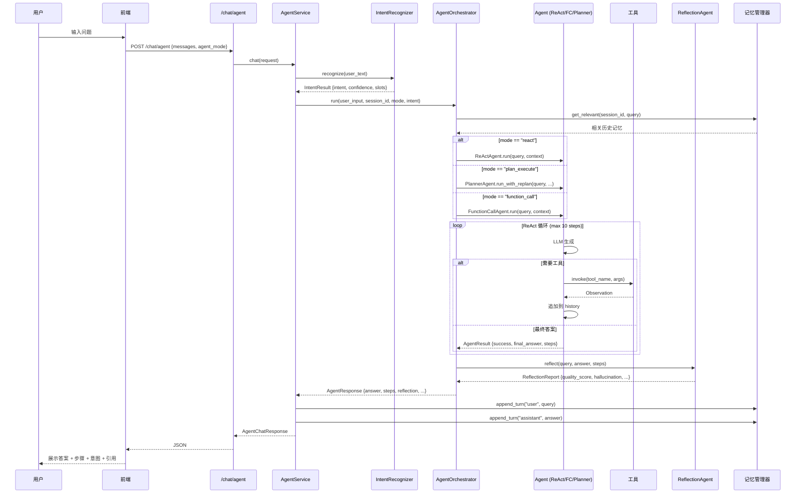
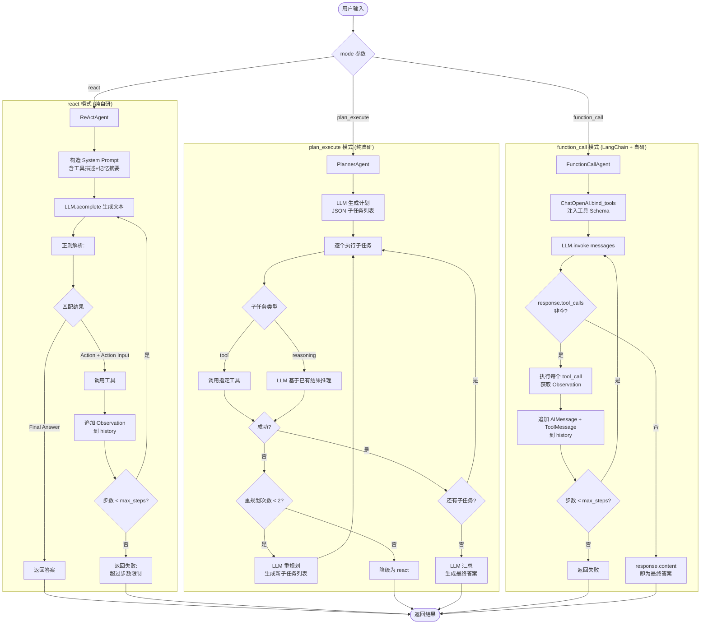
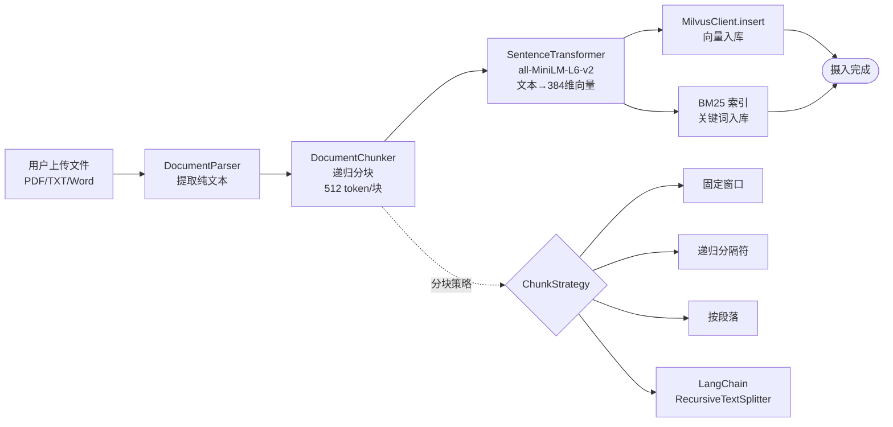
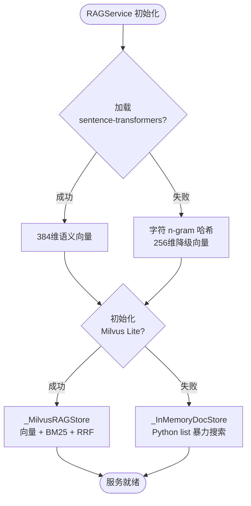
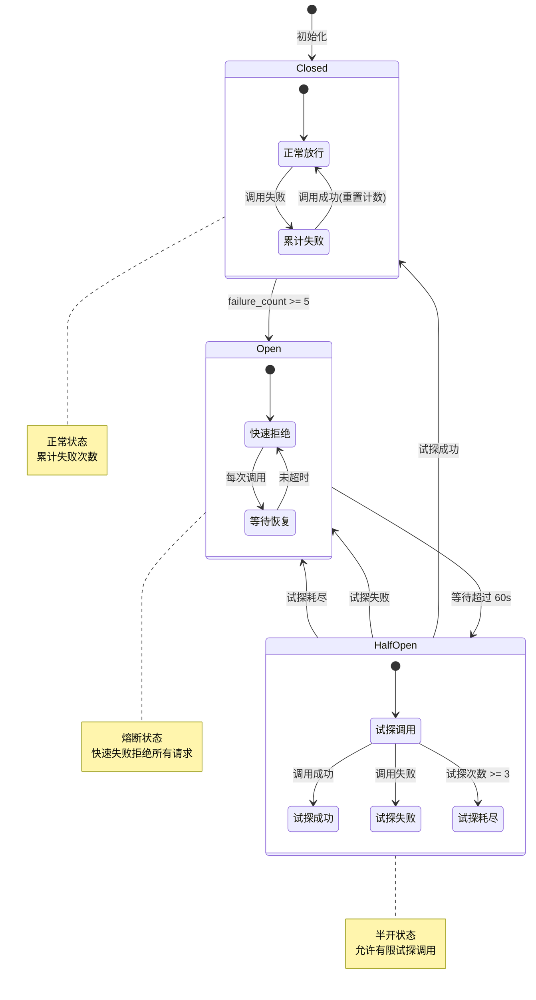
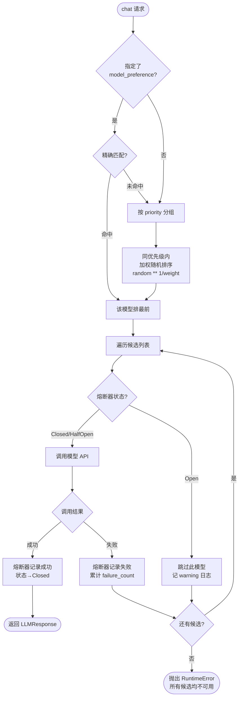
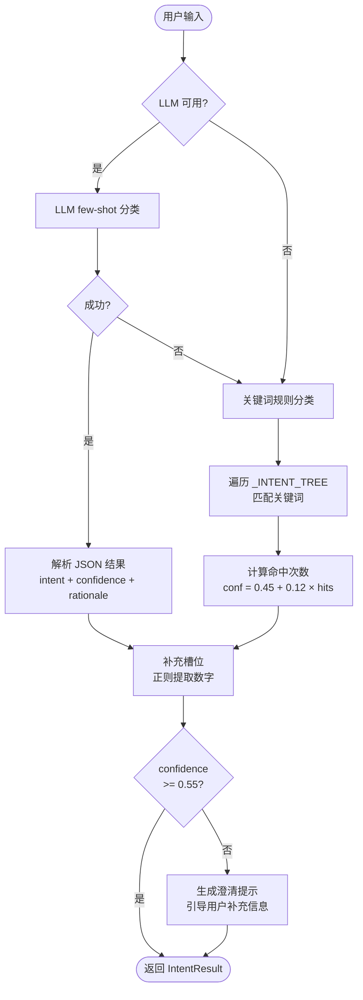
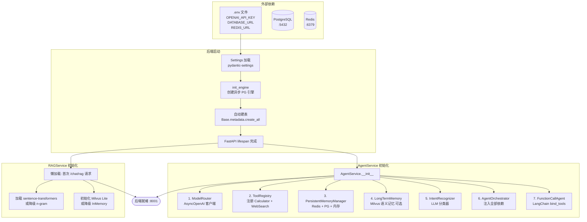

# 项目流程框图

> 使用 Mermaid 绘制的项目流程框图合集。在支持 Mermaid 的 Markdown 阅读器中可直接渲染（GitHub、VSCode + 插件、Typora 等均支持）。

---

## 1. 整体系统架构

```mermaid
graph TB
    subgraph 前端["前端 (React + TypeScript)"]
        UI[三栏布局<br/>侧边栏 | 对话区 | 详情面板]
    end

    subgraph API["API 层 (FastAPI :8001)"]
        R1["/chat"]
        R2["/chat/stream"]
        R3["/chat/agent"]
        R4["/chat/rag"]
        R5["/sessions"]
        R6["/documents"]
    end

    subgraph 核心["核心业务层"]
        AgentSvc[AgentService<br/>顶层组装]
        Intent[IntentRecognizer<br/>意图识别]
        Orch[AgentOrchestrator<br/>编排器]
        Memory[PersistentMemoryManager<br/>三层记忆]
        RAG[RAGService<br/>知识库服务]
        Tools[ToolRegistry<br/>工具注册中心]
    end

    subgraph Agent引擎["Agent 引擎"]
        React[ReActAgent<br/>正则解析]
        Planner[PlannerAgent<br/>规划执行]
        FC[FunctionCallAgent<br/>LangChain FC]
        Refl[ReflectionAgent<br/>反思评估]
    end

    subgraph 基础设施["基础设施层"]
        PG[(PostgreSQL<br/>会话+消息)]
        Redis[(Redis<br/>短期记忆)]
        Milvus[(Milvus Lite<br/>向量库)]
        LLM[ModelRouter<br/>多模型路由]
        CB[CircuitBreaker<br/>三态熔断]
    end

    UI --> API
    R3 --> AgentSvc
    AgentSvc --> Intent
    AgentSvc --> Orch
    AgentSvc --> Memory
    AgentSvc --> Tools
    Orch --> React
    Orch --> Planner
    Orch --> FC
    Orch --> Refl
    Memory --> Redis
    Memory --> PG
    Memory --> Milvus
    RAG --> Milvus
    Tools --> LLM
    LLM --> CB
    R4 --> RAG
```

---

## 2. Agent 对话主流程



---

## 3. 三种 Agent 模式对比流程



---

## 4. RAG 全链路流程

### 4.1 文档摄入



### 4.2 混合检索 + 生成

```mermaid
flowchart TD
    QUERY([用户问题]) --> ENCODE[SentenceTransformer<br/>文本→384维向量]

    ENCODE --> VEC[Milvus 向量检索<br/>COSINE 相似度<br/>top_k × 2]
    QUERY --> KW[BM25 关键词检索<br/>Okapi 算法<br/>top_k × 2]

    VEC --> RRF[RRF 倒数排名融合<br/>score = Σ 1/60+rank+1<br/>按融合分降序]
    KW --> RRF

    RRF --> RERANK[Cross-Encoder 精排<br/>ms-marco-MiniLM-L-6-v2<br/>(query, doc) 对打分]
    RERANK --> TOPK[取 top_k 结果]

    TOPK --> PROMPT[构造 Prompt<br/>[1] 上下文1<br/>[2] 上下文2<br/>+ 历史对话 + 问题]
    PROMPT --> LLM[LLM 生成答案]
    LLM --> CITE[正则提取 [n] 引用<br/>映射到文档块]
    CITE --> RESP([返回 RAGResponse<br/>答案 + 引用列表])
```

### 4.3 降级策略



---

## 5. 记忆系统三层级联

```mermaid
flowchart TD
    subgraph 写入["写入路径 (append_turn)"]
        W1[Agent 完成一轮对话] --> W2[内存兜底<br/>_InMemoryMemoryManager<br/>同步写入]
        W2 --> W3[PostgreSQL<br/>SessionRepository<br/>异步写入]
        W2 --> W4[Redis<br/>ShortTermMemory<br/>异步写入]
        W3 --> W_OK([写入完成])
        W4 --> W_OK
    end

    subgraph 读取["读取路径 (get_relevant)"]
        R1[Agent 需要记忆上下文] --> R2{Redis 可用?}
        R2 -->|是| R3[ShortTermMemory<br/>get_relevant]
        R3 --> R3_OK{有结果?}
        R3_OK -->|是| R_ADD_LTM
        R3_OK -->|否| R4
        R2 -->|否| R4{PostgreSQL 可用?}
        R4 -->|是| R5[SessionRepository<br/>get_recent_messages]
        R5 --> R_ADD_LTM
        R4 -->|否| R6[内存兜底<br/>get_relevant]
        R6 --> R_ADD_LTM

        R_ADD_LTM[追加长期语义记忆<br/>LongTermMemory.recall<br/>Milvus 语义召回 top_3]
        R_ADD_LTM --> R_TRUNC[语义记忆插入最前<br/>然后截断到 limit]
        R_TRUNC --> R_DONE([返回记忆列表])
    end

    subgraph 压缩["Redis 自动压缩"]
        C1[每次 add_message 后检查] --> C2{消息数 > 20 或<br/>总 token > 4000?}
        C2 -->|否| C_SKIP([跳过])
        C2 -->|是| C3[保留尾部 10 条]
        C3 --> C4[对其余消息<br/>LLM 生成摘要]
        C4 --> C5[摘要作为 SystemMessage<br/>替换 Redis 中的列表]
    end
```



---

## 6. 三态熔断器状态机



---

## 7. 模型路由决策流程



---

## 8. 意图识别流程



---

## 9. 工具调用流程 (FunctionCall 模式)

```mermaid
sequenceDiagram
    participant FC as FunctionCallAgent
    participant LLM as ChatOpenAI<br/>(bind_tools)
    participant TL as 具体工具
    participant H as History

    FC->>LLM: invoke(messages)
    Note over LLM: LLM 从 tools Schema 中<br/>判断是否需要调用工具

    LLM-->>FC: AIMessage {content, tool_calls}

    alt tool_calls 非空
        FC->>FC: 解析 tool_calls[0]<br/>{name, args, id}
        FC->>H: 追加 AIMessage(tool_calls=...)
        
        loop 每个 tool_call
            FC->>TL: ainvoke({args})
            TL-->>FC: 返回结果字符串
            FC->>H: 追加 ToolMessage<br/>(content=结果, tool_call_id=id)
        end
        
        FC->>FC: 步数+1, 继续循环
    else tool_calls 为空
        FC-->>FC: response.content = 最终答案
        FC->>H: 记录最终步骤
    end
```

---

## 10. 项目启动与依赖拓扑



---

## 图例说明

| 符号 | 含义 |
|------|------|
| `[文本]` 方框 | 处理节点 |
| `(文本)` 圆角框 | 起始/终止 |
| `{文本}` 菱形 | 判断分支 |
| `[(文本)]` 圆柱 | 数据库/存储 |
| `-->` 实线箭头 | 主流程 |
| `-.->` 虚线箭头 | 可选/降级路径 |
| `Note` | 注释说明 |
